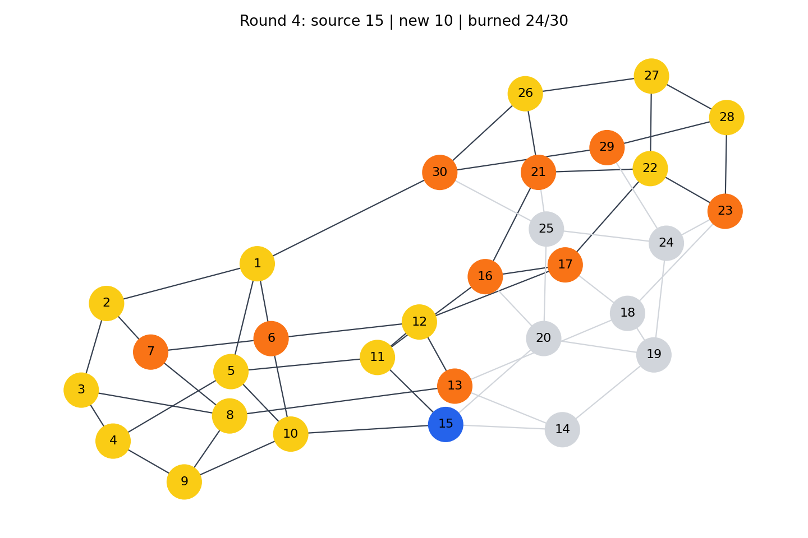

# Verified 30-node random-source Graph Burning experiment

The `python-preview/` folder contains local Python predictions from
`scripts/show_burning_rounds.py` for
[`datasets/thirty-node-random-burning-seed-20261026/`](../../datasets/thirty-node-random-burning-seed-20261026/).
The `lab-round-preview/` folder contains the lab-PC Python preview's
`expected.tsv`, round tables, four PNGs and four GraphML subgraphs.
`giraph-actual.tsv` is the **fresh Giraph output** copied from HDFS.

Four randomly selected eligible sources, using seed `20261026`, are
`4:27:12:15`. The Python program predicts 24 burned vertices and six
unburned vertices (`14,18,19,20,24,25`) after round 4. The
`python-preview/` contains `expected.tsv` and round-by-round node and
burned-edge tables. The lab job read the three `part-*.txt` files from
`/user/mca2025/giraph_learning/graph_burning_30_random_20261026_input`
and wrote readable output to
`/user/mca2025/giraph_learning/graph_burning_30_random_20261026_output/part-00000`.
The runner used `LearningGraphBurningFromInputComputation`, not a Python-only
simulation. On the lab PC, `diff -u` between the lab Python `expected.tsv`
and HDFS output printed nothing; exit code was **0**. The copied files also
match line for line locally. Windows-generated `python-preview/expected.tsv`
uses CRLF while the copied HDFS output uses LF, so raw file hashes differ
only because of line endings.

| Round | Selected source | Newly burned (including source) | Cumulative burned |
|---:|---:|---|---:|
| 1 | 4 | 4 | 1 |
| 2 | 27 | 3, 5, 9, 27 | 5 |
| 3 | 12 | 1, 2, 8, 10, 11, 12, 22, 26, 28 | 14 |
| 4 | 15 | 6, 7, 13, 15, 16, 17, 21, 23, 29, 30 | 24 |

The six vertices still unburned after round 4 are 14, 18, 19, 20, 24 and
25. A `round-XX-burned.graphml` file is the **induced subgraph** on vertices
burned by that round; an edge in it is not necessarily the specific route
of flame propagation. The PNG colours have the meanings explained in the
[Hinglish code guide](../../study-material/hinglish-code-guide/show-burning-rounds-Hinglish.md).
The random sequence is reproducible via its seed but is not optimized.

| Round | Lab PNG | Burned subgraph | Lab node states | Lab burned edges |
|---:|---|---|---|---|
| 1 | [PNG](lab-round-preview/round-01.png) | [GraphML](lab-round-preview/round-01-burned.graphml) | [nodes.tsv](lab-round-preview/round-01-nodes.tsv) | [edges.tsv](lab-round-preview/round-01-burned-edges.tsv) |
| 2 | [PNG](lab-round-preview/round-02.png) | [GraphML](lab-round-preview/round-02-burned.graphml) | [nodes.tsv](lab-round-preview/round-02-nodes.tsv) | [edges.tsv](lab-round-preview/round-02-burned-edges.tsv) |
| 3 | [PNG](lab-round-preview/round-03.png) | [GraphML](lab-round-preview/round-03-burned.graphml) | [nodes.tsv](lab-round-preview/round-03-nodes.tsv) | [edges.tsv](lab-round-preview/round-03-burned-edges.tsv) |
| 4 | [PNG](lab-round-preview/round-04.png) | [GraphML](lab-round-preview/round-04-burned.graphml) | [nodes.tsv](lab-round-preview/round-04-nodes.tsv) | [edges.tsv](lab-round-preview/round-04-burned-edges.tsv) |

The [lab Python expected TSV](lab-round-preview/expected.tsv), [local Python expected TSV](python-preview/expected.tsv), and [saved Giraph actual TSV](giraph-actual.tsv) are distinct files with distinct provenance. The [experiment index](../../docs/EXPERIMENT-INDEX.md) maps them to the exact three-part input.

